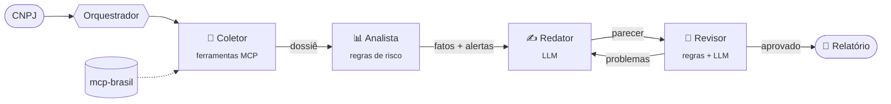

# 🕵️ due-diligence-agentes

[](https://github.com/Arthurpereiraa/due-diligence-agentes/actions/workflows/ci.yml)

-000000?logo=ollama&logoColor=white)

[](LICENSE)

**Sistema multiagente que faz due diligence de empresas brasileiras pelo CNPJ.** Agentes especializados coletam os dados públicos, calculam o risco, escrevem um parecer e revisam uns aos outros. Tudo roda **localmente e de graça**, com [Ollama](https://ollama.com).

Os dados vêm do servidor MCP [**mcp-brasil**](https://github.com/Arthurpereiraa/mcp-brasil) (Receita Federal, Correios e mais, via BrasilAPI).

```bash
diligencia analisar 11.222.333/0001-81 98.765.432/0001-98
```

## Como funciona



| Agente | Papel | Usa LLM? |
|---|---|:---:|
| **Coletor** | Valida o CNPJ, consulta a Receita e **cruza com o CEP** para conferir se o endereço bate | — |
| **Analista** | Aplica as regras de risco: situação cadastral, idade, MEI, capital, endereço, contato, sócios | — |
| **Redator** | Interpreta os achados e escreve o parecer com recomendações | ✅ |
| **Revisor** | Confere se o parecer é fiel aos fatos e devolve para o redator corrigir | ✅ + regras |
| **Investigador** | Responde perguntas livres decidindo sozinho quais ferramentas usar (*tool calling*) | ✅ |

### Decisões de projeto

- **Determinístico onde precisão importa, LLM onde linguagem importa.** Buscar dados e calcular o risco são tarefas com resposta certa, então ficam com código testado. O modelo entra para explicar, recomendar e revisar. Assim o resultado é reproduzível e funciona bem com modelos locais pequenos, que erram mais quando precisam planejar sozinhos.
- **Revisor em duas camadas contra alucinação.** Todo CNPJ, data e valor em R$ citado pelo redator precisa existir nos fatos, e o nível de risco não pode ser alterado. Essa checagem é feita por código. Depois, um segundo LLM aponta afirmações sem respaldo. Se houver problema, o redator reescreve (até 2 vezes); se não resolver, o relatório sai com um aviso explícito.
- **A tabela de fatos nunca passa pelo LLM.** Ela é montada por código, e o modelo escreve só a parte interpretativa.
- **Zero dependências.** O cliente MCP (JSON-RPC sobre stdio) e o cliente do Ollama (HTTP) usam só a biblioteca padrão do Python.
- **Provedor plugável.** Qualquer objeto com o método `chat()` serve como LLM, o que facilita trocar o Ollama por outro provedor.

## Instalação

Requisitos: **Python 3.10+**, **Node.js 20+** (para o mcp-brasil) e o **[Ollama](https://ollama.com/download)**.

```bash
# 1. Baixe um modelo (uma vez só)
ollama pull qwen2.5:7b          # recomendado: bom em português e em tool calling (~4,7 GB)
# ollama pull llama3.2:3b       # alternativa mais leve para máquinas com pouca RAM

# 2. Instale o projeto
git clone https://github.com/Arthurpereiraa/due-diligence-agentes.git
cd due-diligence-agentes
pip install -e .
```

## Uso

```bash
# Relatório completo com parecer dos agentes
diligencia analisar 11.222.333/0001-81

# Vários CNPJs, com tabela comparativa no final, salvos em arquivo
diligencia analisar 11.222.333/0001-81 98.765.432/0001-98 --saida relatorio.md

# Sem IA: só dados e regras (não precisa do Ollama)
diligencia analisar 11.222.333/0001-81 --sem-ia

# Resultado estruturado para integrar com outros sistemas
diligencia analisar 11.222.333/0001-81 --json

# Pergunta livre: o agente investigador escolhe as ferramentas
diligencia perguntar "Qual o vencimento de 10 dias úteis a partir de hoje?"
diligencia perguntar "Qual banco é o 077?"

# Lista as ferramentas disponíveis no mcp-brasil
diligencia ferramentas
```

Veja um [relatório de exemplo](exemplos/relatorio-sem-ia.md), gerado sobre dados fictícios.

### Configuração

| Variável | Padrão | Para quê |
|---|---|---|
| `DILIGENCIA_MODELO` | `qwen2.5:7b` | Modelo do Ollama (ou use `--modelo`) |
| `OLLAMA_HOST` | `http://localhost:11434` | Ollama em outra máquina da rede |
| `MCP_BRASIL_CMD` | `npx -y mcp-brasil@0` | Outro comando para subir o servidor MCP |

## Regras de risco

| Condição | Nível |
|---|---|
| Situação cadastral diferente de ATIVA | 🔴 Alto |
| Empresa com menos de 6 meses | 🔴 Alto |
| Empresa com menos de 2 anos | 🟡 Médio |
| Situação cadastral alterada nos últimos 90 dias | 🟡 Médio |
| Optante pelo MEI (limite anual de faturamento) | 🟡 Médio |
| Capital social abaixo de R$ 10.000 com porte DEMAIS | 🟡 Médio |
| CEP cadastrado pertence a outra cidade ou UF | 🟡 Médio |
| Sem e-mail e sem telefone | ⚪ Informativo |
| Sociedade sem sócios listados | ⚪ Informativo |

O risco geral é o nível mais alto entre os alertas: 🔴, 🟡 ou 🟢 Baixo.

## Desenvolvimento

```bash
pip install -e ".[dev]"
pytest                                   # testes com servidor MCP e LLM falsos (offline)
INTEGRACAO_MCP=1 pytest                  # inclui a integração com o mcp-brasil real
ruff check . && ruff format --check .    # lint
```

Os testes usam um **servidor MCP falso** (um subprocesso que fala JSON-RPC de verdade) e um **LLM roteirizado**. Assim dá para testar o ciclo redator/revisor, o tool calling do investigador e os erros sem depender de rede nem de GPU. O CI roda em Linux e Windows.

## Limitações

- Os dados são públicos e podem ter alguns dias de atraso em relação à Receita.
- A análise **não substitui** certidões negativas, consultas a protestos e processos judiciais.
- A qualidade do parecer depende do modelo: modelos de 7B ou mais têm resultados bem melhores que os de 3B.

## Feito com IA

Projeto escrito em pair programming com o [Claude](https://claude.ai). Ele faz parte de uma série:

- [x] [mcp-brasil](https://github.com/Arthurpereiraa/mcp-brasil), o servidor MCP
- [x] [brasil-toolkit](https://github.com/Arthurpereiraa/brasil-toolkit), plugin do Claude Code
- [x] **due-diligence-agentes**, este sistema multiagente
- [ ] App 100% vibecodado

## Licença

[MIT](LICENSE)
